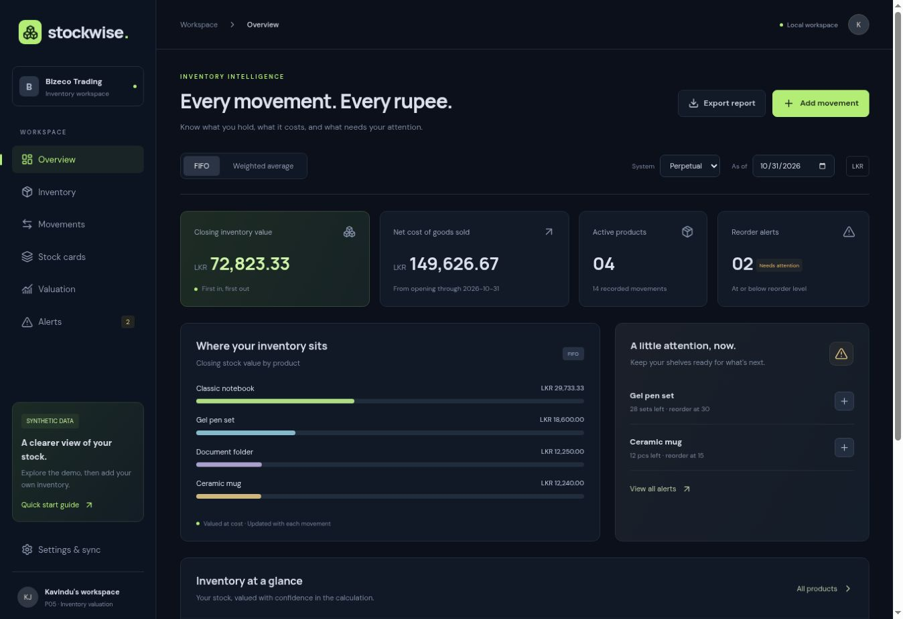

# Stockwise — P05 Inventory Valuation System

React + TypeScript + Firebase-ready inventory costing MVP, created for Kavindu's accounting portfolio. Includes synthetic demo records. No verified financial compliance claim.

[Open live demo](https://j-kavindu.github.io/p05-inventory-valuation/) · [Deployment workflow](https://github.com/j-kavindu/p05-inventory-valuation/actions/runs/38327249966)



## Run

Node.js 22.12+ (tested on 24.19) and npm:

```sh
npm ci
npm test
npm run build
npm run dev
```

Open the Vite development URL. No Firebase configuration is necessary for the fully interactive local demo. `.env.example` documents optional cloud configuration.

## Features

- Responsive dark dashboard, searchable product catalogue and movement ledger.
- Product creation with SKU, category, unit and reorder point.
- Opening stock, purchases, sales, purchase returns and sales returns.
- Four combinations: perpetual FIFO, moving weighted average, periodic FIFO and periodic weighted average.
- Quantity/cost stock cards, remaining FIFO layers, method comparison and reconciliation.
- As-of reporting, low-stock alerts, negative-stock blocking, cumulative linked-return validation.
- CSV valuation and stock-card exports; JSON backup/restore; browser print/save PDF for guide.
- Local persistence; optional Google sign-in and explicit version-checked Firestore save/load.
- Decimal.js 40-digit arithmetic. Display amounts rounded to two decimals, quantity/cost input limited to six decimals.

## Deliverables

- `src/valuation.ts`: standalone pure valuation engine, data contracts, validation, CSV export utility.
- `tests/valuation.test.ts`: separate valuation suite with 26 tests, hand-calculated expected results and invariant checks.
- `src/main.tsx`, `src/style.css`: React application and responsive styling.
- `src/demo.ts`, `demo-data.json`: reusable synthetic dataset.
- `src/firebase.ts`, `firestore.rules`, `firebase.json`, `.env.example`: Firebase adapter, ownership rules and hosting configuration.
- `docs/ARCHITECTURE.md`: data model, processing, persistence and security boundaries.
- `docs/DEPLOYMENT.md`: Firebase setup, hosting and validation steps.
- `docs/VALUATION-POLICIES.md`: exact accounting assumptions and return policies.
- `docs/VERIFICATION.md`: verification evidence and outstanding limitations.
- `docs/SCREENSHOTS.md`: screenshot availability and reproducible capture instructions.

## Quick start

The demo opens in October 2026 with four products. Explore the method/system switches, then use Settings to download a backup or start an empty workspace. Add products first, followed by opening stock or purchases. Add sales using quantities; the app computes issue cost. Use the original transaction reference when recording a return.

The report end date initially covers the demo month. Change it when entering transactions in later periods. This MVP is a **single reporting period** from opening stock through the chosen end date. It is not a multi-period close/reopen accounting system.

## Verification

`npm test`: 26 passing tests. `npm run build`: TypeScript and Vite production build passed. GitHub Actions successfully tested, built and deployed the app to GitHub Pages. A live desktop smoke check verified dashboard rendering and switching from perpetual FIFO to periodic weighted average; the screenshot above is from the deployed app. Mobile browser QA, deployed Firebase authentication, Firestore rules emulator tests and cloud round trips remain **unverified**. See `docs/VERIFICATION.md`.

## Limitations

Single currency (LKR), single warehouse, 200 products, 2,000 movements and a 700 KB serialized workspace. No tax, revenue tracking, NRV adjustments, manufacturing costs, transfers, period locks, external integrations or immutable audit trail. All return references must exist in the same workspace/period. Movements are append-only in the UI; backup import can replace the ledger. Client-side costing is appropriate for this personal MVP, not a tamper-proof multi-user inventory service.

Firebase hosting is separately deployable using your project. The supplied hosted demonstration uses local storage until configured. No Firebase project was created or claimed to be connected.
