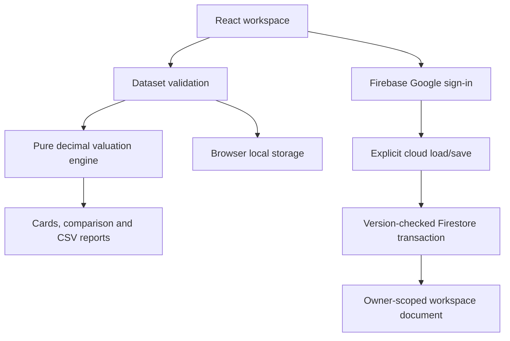

# Architecture and data model

## Contracts

`Product`: `id` (SKU, unique), `name`, `category`, `unit`, `reorder` (non-negative quantity threshold).

`Movement`: unique `id`, `productId`, ISO `date`, `kind` (`opening`, `purchase`, `sale`, `purchase_return`, `sale_return`), decimal-string `quantity`, decimal-string `unitCost` for receipts, original `reference` for returns, and `note`.

`Dataset`: schema `version: 1`, `products`, `movements`. Decimal strings prevent JSON number precision loss. Movement array order is authoritative within a calendar date. Dates are sorted before replay; backdating triggers complete revalidation.

`Valuation`: quantity, closing cost, net COGS, available cost, quantity/cost rows and remaining FIFO layers. Values are decimal strings. Periodic interim cost cells are null, never misleading zeroes.

## Boundaries

`valuation.ts` has no React, storage, network or Firebase dependency. Every mutation validates all products under all four combinations before replacing the local dataset. The app derives reporting results on demand; it does not persist mutable balance totals that can drift from movements.

Local commit: validate → serialize to localStorage → update React state. If saving fails, the old state stays in place. Invalid local storage falls back to the demo on startup; users should retain JSON backups independently. Imports use schema and full ledger validation before confirmation/replacement.

Cloud path: `/users/{uid}/inventory/workspace`, with `{data, revision, updatedAt}`. Google identity scopes access. `saveCloud` performs a read/version-check/write transaction; revision mismatches reject stale saves. A fresh sign-in starts at revision zero, requiring a load before overwriting an existing cloud workspace. Cloud loads replay all validations before local replacement.

Sync is manual and explicit. There is no background last-write-wins sync and no offline cloud-write queue. Local data is not cleared when signing out; use a trusted browser. The default demo is local, unauthenticated, and does not contact Firebase without build-time configuration.

## Security and operational boundaries

Firestore rules deny unmatched paths and restrict workspace access to the authenticated owner. They constrain top-level shape, document revision and list sizes. They do **not** verify each inventory calculation or guarantee nested element validity. A malicious authenticated owner can modify their own data using another client. A trusted server-side posting service would be needed for enforceable accounting invariants, cross-user collaboration, transaction audit trails and period locks.

The workspace is limited to 700 KB to stay below Firestore's document-size ceiling with overhead. This whole-document MVP deliberately favors simplicity over large-scale inventory throughput. No service-account keys are included. Firebase web config is public configuration; security depends on deployed rules and authorized authentication domains.

React renders user strings as text. CSV values are quoted, embedded quotes escaped, and leading formula characters neutralized. Imports and browser storage are treated as untrusted data. Client outputs are cost calculations, not audited accounting statements.
